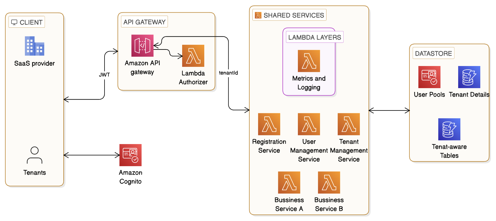
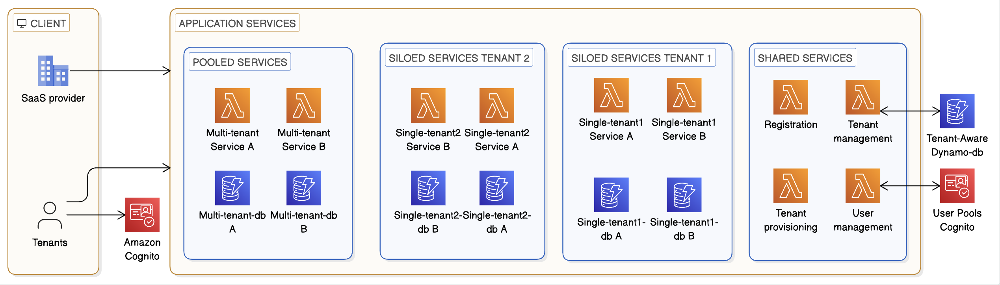
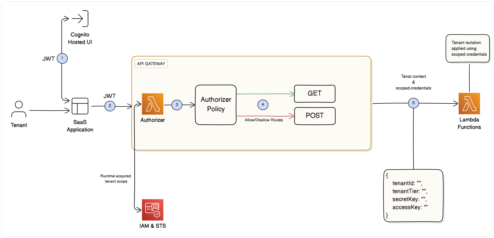
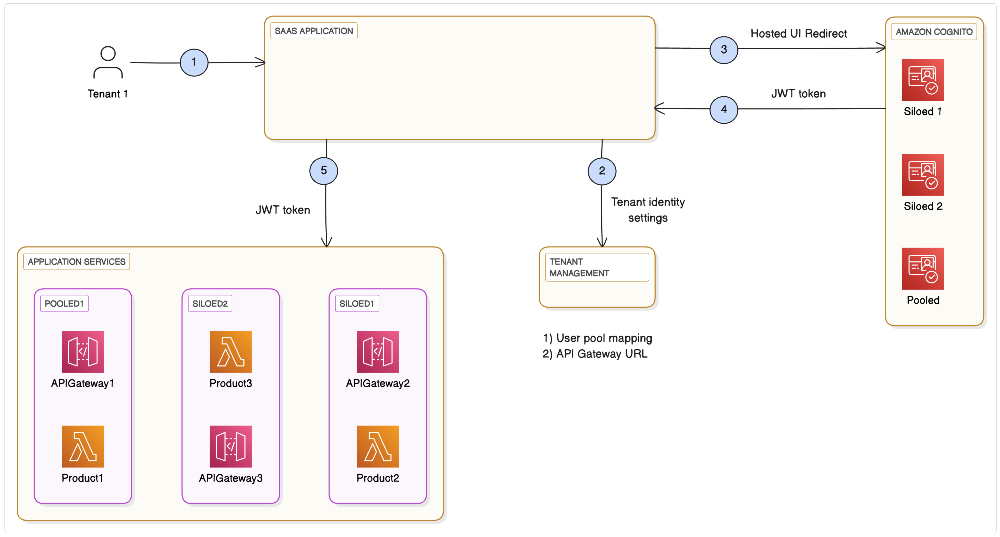
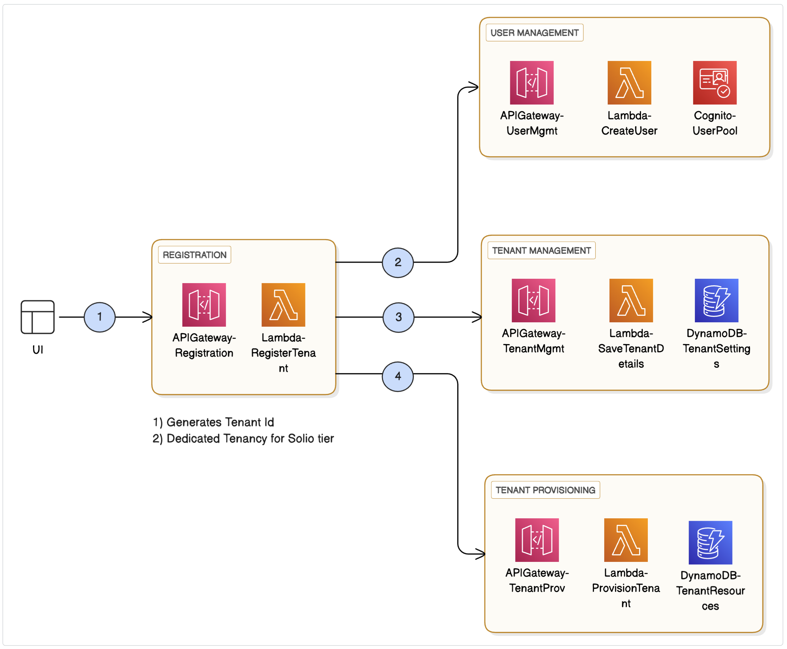
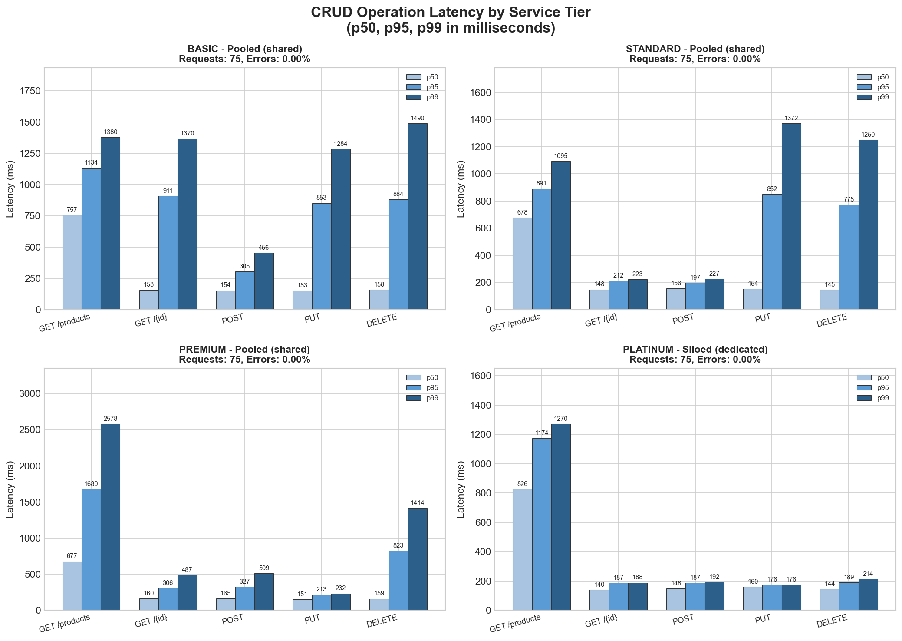
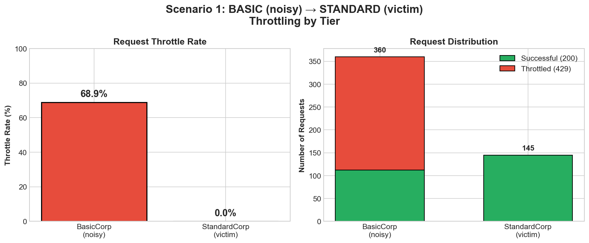
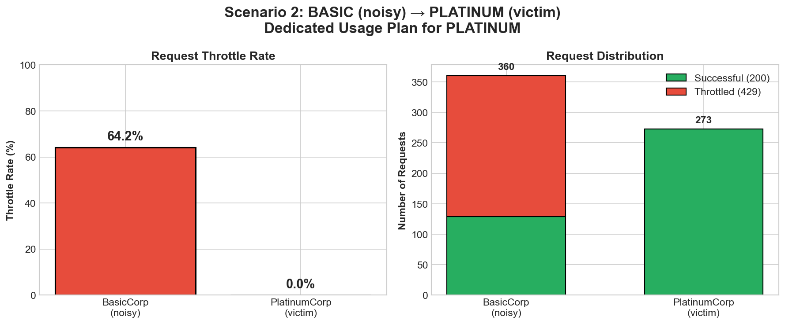
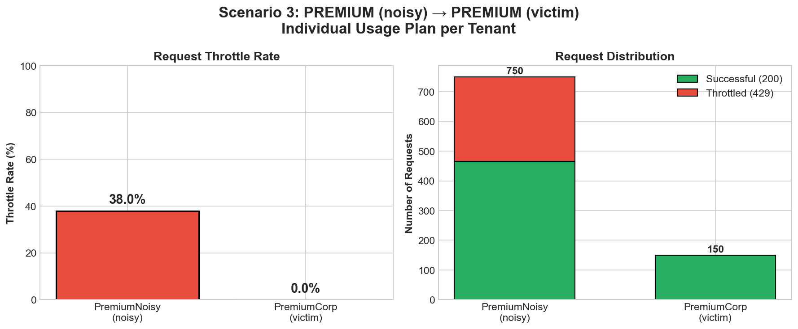

# Serverless Architecture in Multi-Tenant Web Applications

[](https://github.com/tori-27/serverless-multi-tenant-saas/actions/workflows/ci.yml)

> Master's thesis project: *Serverless architektúra v multitenantných webových aplikáciách*
> Technical University of Košice, Faculty of Electrical Engineering and Informatics, Department of Computers and Informatics
> Author: **Bc. Dmytro Poslavskyi** · Supervisor: Ing. Dominik Lakatoš, PhD. · Consultant: Ing. Tomáš Kormaník

This repository contains a multi-tenant SaaS backend built on AWS serverless services (API Gateway, Lambda, DynamoDB, Cognito, STS, CodePipeline). It supports several **isolation levels per tenant tier** and runs from fully pooled shared infrastructure to a dedicated (siloed) stack per tenant. The repository also contains the load tests that check tenant isolation and noisy-neighbour behaviour.

## Thesis goals

1. Analyse existing multi-tenant architecture approaches by isolation, cost and scalability.
2. Design a multi-tenant SaaS architecture on AWS serverless services that supports different isolation levels per tenant type.
3. Implement it, including authentication, authorization, data isolation and per-tier rate limiting.
4. Load-test it with a focus on tenant isolation and cross-tenant load impact.
5. Evaluate performance characteristics against expectations.
6. Document the solution.

## Architecture



The system has these parts:

- **Client.** The SaaS provider (system admins) and tenant users call one REST API with a Cognito JWT.
- **API Gateway + Lambda Authorizer.** The authorizer validates the token, resolves the tenant and returns the tenant context with scoped credentials.
- **Shared services.** Registration, tenant management, tenant provisioning and user management.
- **Business services.** `ProductService` and `OrderService` are the sample tenant-aware CRUD domain.
- **Datastore.** Cognito user pools, tenant metadata tables and tenant-aware business tables.

### Tiers and deployment models



| Tier         | Deployment | Data                                   | Rate limiting                                  |
|--------------|------------|----------------------------------------|------------------------------------------------|
| **BASIC**    | Pooled     | Shared `ProductTable` / `OrderTable`   | Shared tier usage plan: 50 rps, burst 50, 500/day |
| **STANDARD** | Pooled     | Shared tables                          | Shared tier usage plan: 75 rps, burst 100, 3000/day |
| **PREMIUM**  | Pooled     | Shared tables                          | **Per-tenant** API key and usage plan: 100 rps, burst 200, 5000/day |
| **PLATINUM** | **Siloed** | Dedicated `Product-<tenantId>` / `Order-<tenantId>` tables | Dedicated usage plan: 300 rps, burst 300, 10000/day |

On registration, PREMIUM tenants get their own API key and usage plan, created at runtime ([tenant-registration.ts](src/TenantManagmentService/tenant-registration.ts)). PLATINUM tenants are marked `dedicated` and get their own CloudFormation stack from [tenant-template.yaml](tenant-template.yaml). The data layer picks the table from the authorizer context: `Product-<tenantId>` for dedicated tenants, the shared `ProductTable` for everyone else ([ddb.ts](src/shared/ddb.ts)).

## Authentication, authorization and tenant isolation



1. The user signs in through Cognito and receives a JWT with `custom:tenantId` and `custom:userRole`.
2. The client calls API Gateway with `Authorization: Bearer <JWT>`.
3. The **Lambda Authorizer** ([authorizer.ts](src/AuthService/authorizer.ts)) does the following:
   - looks up tenant details (user pool, app client, API key, tier) in `ServerlessSaaS-TenantDetails` and rejects unknown or deactivated tenants;
   - verifies the JWT against that tenant's user pool with `aws-jwt-verify`, and from then on uses only the verified claims;
   - calls **STS AssumeRole** with an inline session policy. The policy restricts DynamoDB access to items whose partition key starts with the tenant's ID (`dynamodb:LeadingKeys = <tenantId>-*`). If this fails, the request is denied;
   - returns an IAM policy, a tenant context (`tenantId`, `userRole`, tier, scoped credentials) and a `usageIdentifierKey`. The API's key source is `AUTHORIZER`, so API Gateway uses that key to pick the tenant's **usage plan**. Clients don't send an `x-api-key` header and can't choose another tier's plan.
4. Business Lambdas call DynamoDB with the **tenant-scoped credentials**, not their own execution role, and there is no fallback to the execution role. A bug in application code therefore cannot read another tenant's rows; a request for another tenant's key fails in IAM and is answered with 404.

The authorizer caches STS credentials (12 min of the 15 min session), tenant details (5 min) and JWT verifiers across warm invocations. This keeps the authorization overhead low.



Roles: `SystemAdmin` and `CustomerSupport` are SaaS provider operators. `TenantAdmin` and `TenantUser` are tenant users.

## Tenant onboarding



`POST /registration` is public and runs these steps in one Lambda:

1. Generates the tenant ID and resolves the tier's API key from SSM, or creates a per-tenant usage plan for PREMIUM.
2. Creates the tenant admin user in Cognito (**User Management**). Cognito emails them a temporary password.
3. Stores tenant details (**Tenant Management**).
4. For PLATINUM, triggers **Tenant Provisioning**. This starts the tenant CodePipeline, which deploys the dedicated stack.

If a step fails, the steps that already succeeded are rolled back in reverse order (usage plan and key, Cognito user, tenant record).

The pipeline ([src/TenantPipeline](src/TenantPipeline)) is an AWS CDK app with three stages: **Source** from GitHub via a CodeStar connection, **Build** with `sam build` and `sam package` ([tenant-buildspec.yml](tenant-buildspec.yml)), and **Deploy**. In the Deploy stage, a Lambda creates or updates one CloudFormation stack per dedicated tenant and records it in `TenantStackMapping`.

## API overview

All endpoints except registration require a Cognito JWT. Roles are checked in the handlers.

| Endpoint | Who can call it |
|---|---|
| `POST /registration` | Public (throttled to 1 rps, burst 5) |
| `GET /products`, `POST /product`, `GET\|PUT\|DELETE /product/{id}` | Any tenant user, own tenant's data only |
| `GET /orders`, `POST /order`, `GET\|PUT\|DELETE /order/{id}` | Any tenant user, own tenant's data only |
| `GET /tenant/{tenantid}` | Own tenant, or SaaS provider |
| `PUT /tenant/{tenantid}` | Tenant admin (own tenant, contact details only), or system admin |
| `GET /tenants` | SaaS provider (`SystemAdmin`, `CustomerSupport`) |
| `POST /tenant`, `PUT /tenant/activation/{tenantid}`, `DELETE /tenant/{tenantid}` (deactivate) | System admin |
| `GET /tenant/init/{tenantname}` | Any signed-in user |
| `POST /user` | Tenant admin (creates `TenantUser`s in own tenant), or system admin |
| `GET /users` | Tenant admin (own tenant), or SaaS provider (`?tenantId=`) |
| `POST /user/tenant-admin`, `PUT /users/disable` | System admin |
| `POST /provisioning`, `PUT /provisioning/{tenantid}` (deprovision) | System admin |

## Repository structure

```
.
├── template.yaml              # SAM template: shared/pooled infrastructure (API, authorizer, tables, Cognito, usage plans)
├── tenant-template.yaml       # SAM template: dedicated (siloed) stack per PLATINUM tenant
├── samconfig.toml             # SAM deploy configuration (eu-central-1)
├── buildspec.yml              # CodeBuild spec for the main stack
├── tenant-buildspec.yml       # CodeBuild spec for tenant stacks
├── .github/workflows/ci.yml  # Typecheck, unit tests, SAM template lint
├── src/
│   ├── AuthService/           # Lambda authorizer (JWT validation, STS scoped credentials, usage-plan key)
│   ├── TenantManagmentService/# Registration, tenant/user management, provisioning
│   ├── ProductService/        # Tenant-aware product CRUD (handlers, service, DAL, tests)
│   ├── OrderService/          # Tenant-aware order CRUD (handlers, service, DAL, tests)
│   ├── TenantPipeline/        # CDK app: CodePipeline that deploys siloed tenant stacks
│   ├── shared/                # Authorizer context and roles, scoped DynamoDB client, base repository
│   └── tests-utils/           # Jest setup, DynamoDB mock, event builders
├── load-tests/                # k6 load tests, raw results, and Python chart generators
└── docs/images/               # Architecture diagrams
```

## Getting started

### Prerequisites

- Node.js 20+ and npm
- AWS CLI configured with credentials
- AWS SAM CLI
- AWS CDK v2 (only for the tenant pipeline)
- [k6](https://k6.io/) and Python 3 with `matplotlib` (only for load tests and charts)

### Build and deploy the shared stack

```bash
npm install
sam build
sam deploy --guided      # or `sam deploy` to use samconfig.toml
```

The tier API keys are passed as `NoEcho` CloudFormation parameters (`PlatinumTierApiKey`, `PremiumTierApiKey`, `StandardTierApiKey`, `BasicTierApiKey`, `SystemAdminApiKey`) and have no defaults. Provide them at deploy time, for example in `sam deploy --guided` or with `--parameter-overrides`. Don't commit them to `samconfig.toml`. The stack stores the tier keys in SSM (`/api-keys/<tier>`) for the registration function.

SaaS provider operators are not created through the API. Create the first system admin in the pooled user pool; `custom:userRole` can only be set at creation:

```bash
aws cognito-idp admin-create-user \
  --user-pool-id <PooledUserPoolId> \
  --username admin \
  --user-attributes Name=email,Value=<email> Name=email_verified,Value=true Name=custom:userRole,Value=SystemAdmin
```

### Deploy the tenant pipeline

```bash
cd src/TenantPipeline
npm install
cdk deploy \
  --parameters GitHubConnectionArn=<codestar-connection-arn> \
  --parameters GitHubOwner=<owner> \
  --parameters GitHubRepo=<repo> \
  --parameters GitHubBranch=main
```

### Run checks

```bash
npm run typecheck
npm test                     # Jest unit tests (authorizer, role checks, registration rollback, DAL)
sam validate --lint          # template lint
```

The same checks run in CI on every push.

## Load testing and results

The tests are in [load-tests/](load-tests) and use k6. Deployment-specific values (API URL, Cognito client ID, test user password, usage plan IDs) are read from `load-tests/.env`, which is gitignored. The test tenant IDs in the scripts match the results below; change them to match your own test tenants.

```bash
cp load-tests/.env.example load-tests/.env   # then fill in your values
./load-tests/run-crud-test.sh     # CRUD latency per tier
./load-tests/run-noisy-test.sh    # Noisy-neighbour scenarios
```

### CRUD latency per tier



Each tier ran 75 requests with 0 % errors. Median latency is about 140–165 ms for single-item operations on every tier. The siloed **PLATINUM** tier has the tightest tail: p99 stays at or below 214 ms for `GET/{id}`, `POST`, `PUT` and `DELETE`. The pooled tiers have p99 tails up to about 1.5 s. `GET /products` (a list query) is the slowest operation on all tiers.

### Noisy-neighbour isolation

| Scenario | Noisy tenant | Victim tenant | Mechanism | Noisy throttled | Victim throttled |
|---|---|---|---|---|---|
| 1 | BASIC | STANDARD | Separate tier usage plans | 68.9 % | **0 %** |
| 2 | BASIC | PLATINUM | Dedicated usage plan + silo | 64.2 % | **0 %** |
| 3 | PREMIUM | PREMIUM | Per-tenant usage plan | 38.0 % | **0 %** |





In all three scenarios the noisy tenant was throttled (HTTP 429) and the victim had no failed requests. Scenario 3 shows that two tenants of the **same** tier stay isolated because each PREMIUM tenant has its own usage plan.

These results were measured before the security hardening described below. In that version clients sent the tier API key in the `x-api-key` header, and PLATINUM requests were served from the pooled tables. The usage plans and their limits are the same, so the throttling behaviour should hold, but the numbers have not been re-measured.

## Security model and known limitations

**Tenant isolation is enforced in three places:**

1. **Identity.** `custom:tenantId` and `custom:userRole` are immutable Cognito attributes and are not writable through the app client, so users can't change their own tenant or role. Only the backend sets them, when it creates a user.
2. **Authorization.** The authorizer accepts only verified tokens of active tenants, and every handler checks the caller's role and tenant.
3. **Data access.** Business functions only get STS credentials whose session policy limits DynamoDB access to the caller's partition keys. If the credentials are missing, requests fail instead of falling back to the execution role.

**Known limitations:**

- **Dedicated compute isn't routed yet.** The PLATINUM stack deploys per-tenant Lambdas, but requests are still served by the pooled Lambdas, against the tenant's dedicated tables. Routing to the dedicated functions (for example with a per-tenant API) is future work.
- **Registration is open.** Anyone can register a tenant, including PLATINUM, which starts a pipeline and a new stack. It's throttled, but a production system would need billing or approval first.
- **Deactivation takes up to about 5 minutes.** The authorizer result and tenant details are cached for up to 5 minutes.
- **Operators have cross-tenant access.** `SystemAdmin` and `CustomerSupport` get cross-tenant data access by design.
- **The authorizer role trust is broad.** `authorizer-access-role` trusts the account root, so any principal in the account that is allowed `sts:AssumeRole` on it can use it.
- **Listing users scans the pool.** `GET /users` reads the whole pooled user pool, because Cognito can't filter on custom attributes.

## Tech stack

TypeScript · AWS SAM · AWS CDK · API Gateway (REST, usage plans) · AWS Lambda (Node.js, esbuild) · Amazon DynamoDB · Amazon Cognito · AWS STS · AWS SSM Parameter Store · AWS CodePipeline / CodeBuild · Jest · k6 · Python / matplotlib

## License

Developed as part of a master's thesis at the Technical University of Košice.
